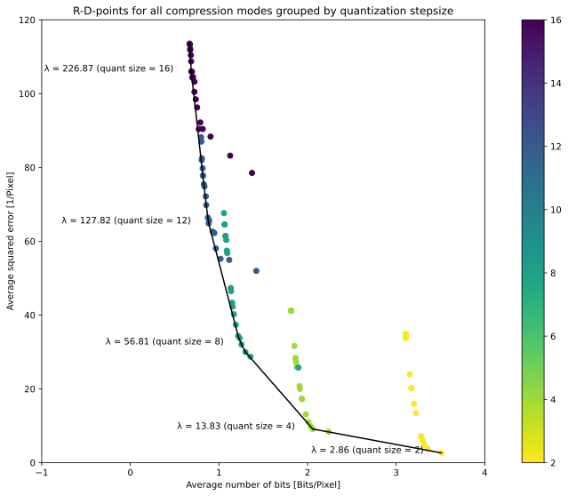
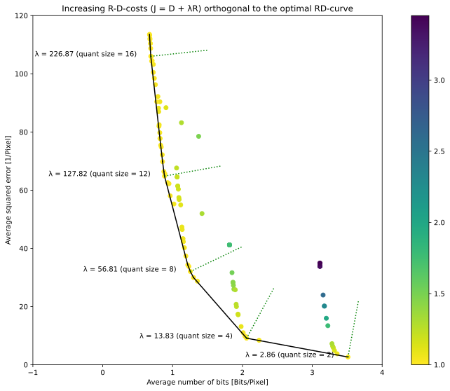

# Aspects of Lagrangian optimization in image compression

In image compressing we generally deal with the question how we can use the highly redundant nature of image data to reduce the memory space needed to save this data. The memory size for raw image data (e.g. data that comes from photo chips) can be enormous. That's why one always tries to compress raw image data. A proven approach is to look at the picture's self-similarities to predict other areas within the image that share a similiar form and color gradient. After predicting a subblock using neighboring content we focus on the difference between prediction and orginal, called the residual. If the prediction is good enough, we should expect a small difference that contains mostly high-frequency details. The comparatively low information density in the residual, in turn, allows us to transform and quantize the residual in order to transfer still less coefficients. However, when the encoder checks different prediction, transform and quantization modes, it must somehow be decided which mode is the best configuration for compression. At this point, many compression standards like JPEG make use of Lagrangian optimization.

## How encoders make decissions

When it comes to image compression, one always has to deal with an interlinked minimization problem: At the same time, we want to minimize the bit rate ($R$) and the squared error ($D$, for distortion) between the compressed and the original image. To solve this minimization problem we can use the Lagrangian approach and instead of minimizing $R$ and $D$ we consider a linear combination $J = D + \lambda R$. The function $J$ is called the Lagrangian function and can be interpreted as a cost value. The lower the coding costs the better is the compression. Thus, we can easily reformulate the minimization problem by only looking at the costs:

$$
J = D + \lambda \cdot R \quad \rightarrow \quad \textrm{min}, \quad \lambda \geq 0
$$

In other words, if we know $\lambda$, comparing two compression modes means nothing else than comparing $J(mode1)$ and $J(mode2)$. The value $\lambda \geq 0$ is the so-called Lagrangian multiplier and becomes necessary since the output bit rate and the output distortion will not increase/decrease in an ratio of 1:1. Figuratively speaking, we have to add an extra penalty to the bit rate in order to get proper RD costs.

However, all compression standards based on rate-distortion-optimization have its own specific Lagrangian multiplier. That is just because different compression algorithms produce different rate-distortion ratios. Consequently, finding the right $\lambda$ is a central task in image compression.

## Determining the Lagrangian multiplier $\lambda$

Let's have a closer look at how we estimate the needed $\lambda$-value(s) for our demo encoder. Since we do not know the specific value yet, the basic idea is to a whole range of different $\lambda$ and $qs$ values. More precisely, we run the encoder application for a set of $(\lambda, qs)$ pairs and generate corresponding $(R(\lambda_i, qs_i), D(\lambda_i, qs_i))$ RD points. By taking these RD points and plot them in the R-D plane we can eventually calculate $\lambda$ from all lambda qs pairs which obtain the highest coding efficiency compared to other RD points. But let's go through step by step.

First, we start with the test space that contains the $(\lambda, qs)$ pairs. For this encoder we define a test space with $5\cdot 20 = 100$ pairs as follows:

$$
QS \times \Lambda = \lbrace 2, 4, 8, 12, 16\rbrace \times {\lbrace 1 + 20i\rbrace}_{i=0}^{19}
$$

Applying the encoder on this test space yields the set of corresponding RD points. This point cloud is plotted in the next figure. There we see that $\lambda$ - $qs$ combinations sometimes cause "bad", and sometimes "good" compression results. The bad ones have high bit rates and high distortions (upper right corner), whereas combinations with a good compression gain lie in the bottom left corner (low rates and low squared errors). Since we are interested in the best $\lambda$-values, we look for the $(\lambda, qs)$ pairs with associated $(R, D)$ points on the convex hull, which is plotted as solid line. This line is also called Pareto frontier, it is assumed to be a linear spline interpolation. One can easily see that there is no other coding point minimizing both rate and distortion. The Pareto Front gives us the optimal rate distortion ratio and, hence, is directly connected to the Lagrange multiplier. So, let $D^{PF}=D(R)$ let be the Pareto frontier. Because the cost functional $J$ must satisfy $\partial_R J(R,D)=0$ we get

$$
\lambda = -\frac{dD^{PF}}{dR}(R)
$$

 

As in other lossy image coder, on the convex hull we typically have points that only depend on the quantization step size. The corresponding best $\lambda$-values are our desired encoder multiplier and we can generelly estimate them by finding a regression model $\lambda = \lambda (qs_{\textrm{best}})$. For this kind of image coder, it's also common to discover a quadratic relation between $\lambda_{\textrm{best}}$ and $qs_{\textrm{best}}$. For example, looking at the HEVC and VVC standard, one founds

$$
\begin{aligned}
qs &= 2 ^ {\frac{QP - 4}{6}} \\
\lambda &= 2 ^ {\frac{QP - 12}{3}},
\end{aligned}
$$

what gives us $\lambda \propto qs^2$. Equally, quadratic regression is a good approach in our demo encoder.

For predicting $\lambda$, we only take those $(R, D)$ points into account which form the Pareto frontier. Then let $\lambda = (\lambda_1, \lambda_2, \ldots, \lambda_n)$ and $qs = (qs_1, qs_2, \ldots, qs_n)$ be the generating Lagrange multipliers and quantization step sizes, respectively. Moreover, let $\hat{\lambda}_k(qs_k) = a\cdot qs_k^2 + b\cdot qs_k + c$ be the quadratic model. Since the model should satisfy the constraint $\hat{\lambda}(1)=0$ we eventually get the model equation $$\hat{\lambda}_k = a\cdot (qs_k^2 - 1) + b\cdot (qs_k - 1)$$ The real-valued coefficient vector $c=(a, b)$ is going to be determined by using least squares:

$$
\begin{aligned}
&c_{best} = \underset{c}{\text{argmin}}\left\lVert \lambda - Ac \right\rVert^2, \quad\text{where} \\; A=
\begin{pmatrix}
qs_1^2 - 1 & qs_1 - 1\\
qs_2^2 - 1 & qs_2 - 1\\
\vdots & \vdots\\
qs_n^2 - 1 & qs_n - 1
\end{pmatrix}\\
\iff & (\lambda - Ac_{best}) \perp Ac_{best}\\
\iff & \langle \lambda - Ac_{best}, Ac_{best} \rangle = 0\\
\iff & c_{best} = (A^\top A)^{-1}A^\top\lambda
\end{aligned}
$$

For our encoder and for the above defined test space, the least squares method yields

$$
\hat{\lambda}_k = 0.876 \cdot (qs_k^2 - 1) + 0.23 \cdot (qs_k - 1)
$$

With this lambda function we sucessfully estimated this encoder's $\lambda$-value and we eventually obtain the coding costs (see second next figure)

$$
J = D(qs, mode) + \lambda(qs) \cdot R(qs, mode)
$$

 

 ## Another perspective on $\lambda$

In the sections above we introduced the cost functional $J=D+\lambda R$ as a linear combination of two varibales that need to be minimized at the same time. Because the gradient of the Lagrange function must vanish, we conclude for the Pareto frontier

$$
0=\partial_R J(R,D)=\frac{dD^{PF}}{dR}(R) + \lambda
$$

An equivalent definition of the Lagrange multiplier $\lambda$ can be given by describing $J$ as orthogonal projection onto the perpendiculars of the Pareto frontier (the dashed lines in last figure). For this purpose, let $x=(R,D)$ be an arbitrary coding point and let $P_U$ be the projection of $x$ on subspace $U=\text{span}\lbrace (1,m_\perp)^\top\rbrace$, where $m_\perp$ is the slope of the current perpendicular. With the projection we can infer a simple geometric interpretation by defining $J$ as a linear transformation, i.e. $J \in\mathfrak{L}(U,\mathbb{R})$.

$$
J=J^{*} \cdot \left\lvert P_U\left(\left(R,D\right)\right)\right\rvert
$$

For the orthogonal projection we set $u=(-m,1)$ which satisfies $(-m,1)\cdot(1,m)^\top=0$. Futhermore, since we have $P_U(x)\in U$, the approach $P_U(x)=\mu u$ yields:

$$
\begin{aligned}
&\langle u, x-P_U(x)\rangle = 0 \\
\iff & \mu = \frac{\langle u, x\rangle}{|u|^2} \\
\iff & P_U(x) = \frac{\langle u, x\rangle}{|u|^2}u
\end{aligned}
$$

If we choose $J^* = |u| = \sqrt{m^2+1}$ for the elementary costs, we will get

$$
\begin{aligned}
J&=J^{*} \cdot \left\lvert P_U\left(\left(R,D\right)\right)\right\rvert \\
&=\left\langle\begin{pmatrix}-m \\\\ 1\end{pmatrix},\begin{pmatrix}R \\\\ D\end{pmatrix}\right\rangle \\
&= D-mR \\
&=D+\lambda R
\end{aligned}
$$

with $\lambda = -m$.